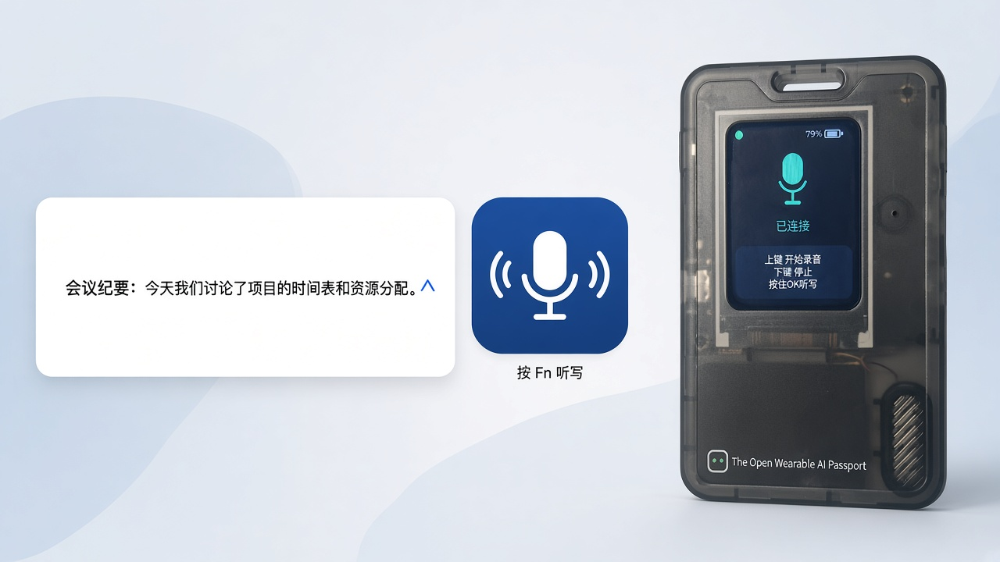

# 本地听写

**在 Mac 菜单栏里把语音写成文字，写到当前光标处**  
识别模型在本机 · 不上传录音 · 可连接电子工牌

[下载安装包](https://github.com/local-voice-assistant/local-dictation/releases/latest) · [安装说明](DOWNLOAD.md) · [隐私说明](legal/PRIVACY.md)

当前版本见 [`latest.json`](latest.json)。

---

## 说话

默认按一下 **Fn** 开始，再说完按一下结束。也可以在设置里改成按住 Fn 说话，或换成 command、option、control、shift。

文字在这一轮说完后一次写入当前光标，不会边说边出字。听的时候会有一块浮层，表示正在听或正在说。

第一次使用要把光标放在要写入的输入框里。若写不进去，到「系统设置 → 隐私与安全性 → 辅助功能」允许「本地听写」。

## 电子工牌

工牌要先在设置里连接。菜单里的「电子工牌」只在已经连上时出现；没连上时不显示，也不能选。断开后如果当时正用着工牌，会回到本机麦克风。

听写过程中：

- 上键：写入这一轮
- 下键：删掉刚写入的一段
- 确认键：换行

本机麦克风听写不使用这三个键。

设置窗口里有电子工牌一栏，会显示蓝牙是否已开启、正在扫描、连接中、已连接或未授权，以及设备名称。可以从这里连接或断开。窗口开着时，这些状态会自己刷新。

## 第一次要重新允许

安装包的标识是 `local.dictation`。即使以前给过「听写」或「本地语音助手」权限，也要再允许一次：

- 麦克风
- 蓝牙（只用电子工牌时需要）
- 辅助功能

模型已经在安装包里，不用再下载。

## 设置

菜单「本地听写设置…」可以改触发键、灵敏度、严格防乱字、电子工牌降噪、历史条数，以及是否发送匿名使用统计。统计默认开着，关掉后不再发送。同一页可以查看电子工牌连接状态，并连接或断开。

数据目录：`~/Library/Application Support/本地听写/`。
